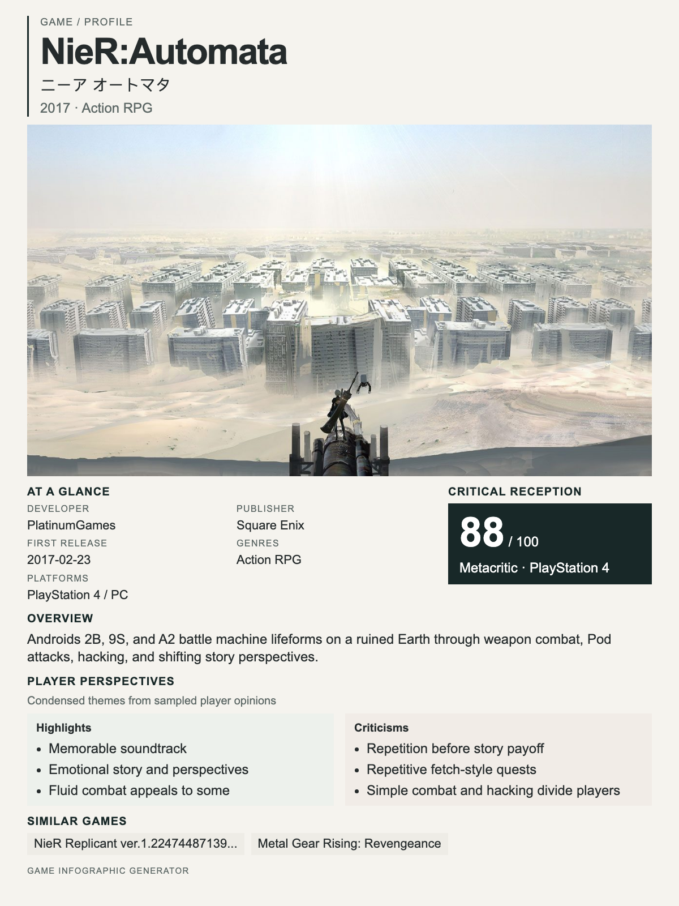

**Status:** In Progress  
**Technologies:** Python, Pydantic, Jinja2, HTML/CSS, Playwright

[View source on GitHub](https://github.com/snowoflondon/game-infographic-generator)

## About the project

**AI content:** This project uses OpenAI's Codex.

Game Infographic Generator (placeholer name) uses game research, structured metadata contract, and HTML/CSS to create portrait infographics for user-requested games.

Game research is agent-assisted and saved as structured JSON file. Pydantic validates that metadata, then renders it into an image using Jinja2 templates, HTML/CSS, and Playwright Chromium. 
Research and rendering are two separate steps.
The renderer works with the output contract generated by research.

This game research and infographic generation steps use agent skills.

## Function

- Runs web search to research user-requested game
- Validates structured game metadata before rendering
- Combines fetched game artwork with release information, platforms, critical reception (Metacritic), and player sentiment.
- Uses compact layouts to fit information onto a portrait canvas with a fixed aspect ratio

The project is a working proof of concept.

Other forms of infographics and refinements of the current output is ongoing.

## Example infographic

This NieR:Automata (one of my favorite games) example was generated during the compact-platforms design iteration. 
It demonstrates the single game layout with representative artwork, game details, Metacritic score, player sentiment, and similar games.

{width=100%}

[Open the full-size infographic](nier-automata-infographic.png)

Game artwork source: [Square Enix’s NieR:Automata post on PlayStation Blog](https://blog.playstation.com/2016/12/22/nier-automata-demo-out-today-on-playstation-store/). Artwork copyright remains with its respective rights holders.
