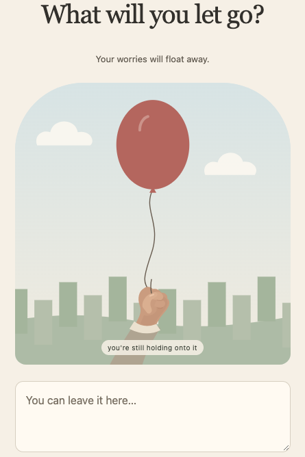

**Status:** In Progress  
**Technologies:** HTML, CSS, JavaScript, SVG

[View source on GitHub](https://github.com/snowoflondon/letting-you-go)

## About the project

**AI content:** This project uses OpenAI's Codex.

Letting You Go is a lightweight web app for expressing and releasing one worry at a time. 

Write a worry, hold a balloon, and release it when ready. The balloon floats through the sky, across multiple locations before disintegrating at its final destination.

## Design

- Plain HTML, CSS, and JavaScript, with local SVG illustrations and no frontend framework or build system.
- Touch, mouse, and keyboard interactions for holding and releasing the balloon.
- A reduced-motion alternative and journey timing that pauses while the tab is hidden.
- Worry text kept in memory for the active session, with no accounts, saved history, or backend transmission.

## See it in action

Try it yourself [here](https://snowoflondon.github.io/letting-you-go/). See below for a screenshot. 

{width=432 fig-alt="Letting You Go: a red balloon held above a city skyline beneath the heading What will you let go?, with a text field for writing a worry."}
