Prior to constructing a machine learning model, several things need to be considered. In a typical ML dataset for classification or regression problems, rows comprise of samples and columns of predictors. These predictor columns are collectively called 'features', which describe some measurements that describe the sample in the problem domain. In real life problems, it is sometimes not feasible to train a ML model on the dataset as-is. 

In some cases, an important predictor variable is excluded in the dataset. This excluded variable is termed a *confounding variable* and its exclusion may result in uninterpretable results. In other cases, several predictors have similar predictive relationship with the variable we're trying to predict - this is the issue of *collinearity* or *multicollinearity*. A perfect multicollinearity occurs when two predictor variables are linear combinations of one another. 

In other cases, a particular dataset may consist of *m* rows and *n* columns where *n* is much larger than *m*. Some models handle this problem of high-dimensionality better than others, but it might still be a good idea to reduce the number of features. The technique used to select a subset of features from the dataset for subsequent data modeling is called *feature selection*.

Feature selection can broadly be divided into two main facets - supervised and unsupervised methods. Unsupervised methods do not take the target variable (i.e., the response we're trying to predict) into consideration. An example of such method is removing correlated variables. Supervised methods do take the target variable into consideration, and aims to remove irrelevant predictors. Among supervised feature selection methods, wrapper methods are commonly used to make selections.

Wrapper methods deploy a ML algorithm in order to select features. The learning algorithm used in the feature selection wrapper does not need to be the same model that is to be used in downstream analysis. 

Recursive feature elimination (RFE) is a popular wrapper feature selection method and as the name suggests, recursively removes less important features until a specified number of features remain. The final number of features need to be specified by the user. This process is summarized below.


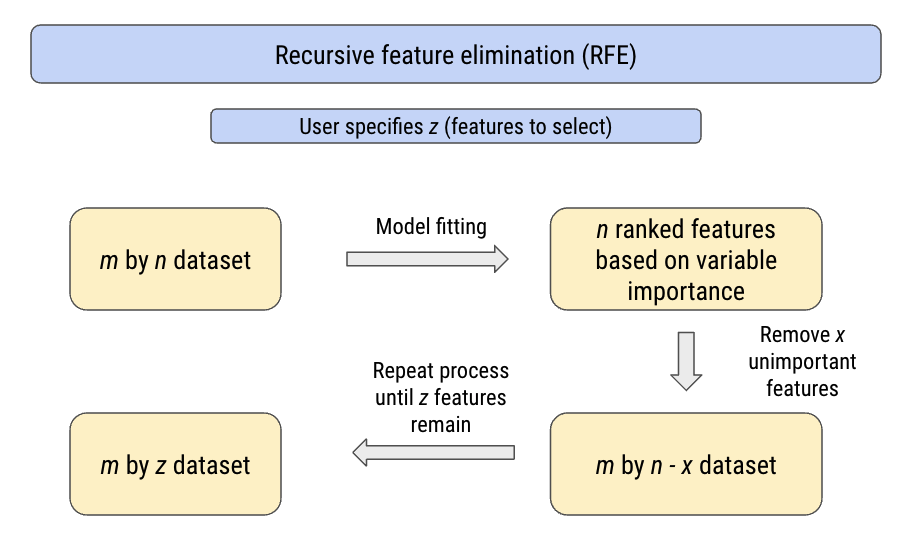


The feature importance used to rank the input features depends on which model was deployed within the RFE algorithm. Tree methods such as decision trees and random forests have built-in methods to deduce variable importance (e.g., node impurity) but other methods can use a more general approach not specific to the model. 

Implementation of RFE is intuitive with sklearn in Python: 


```python
from sklearn.feature_selection import RFE
from sklearn.datasets import make_classification
from sklearn.tree import DecisionTreeClassifier
```


For the sake of this exercise, we will use a synthetic ML dataset.


```python
x, y = make_classification(n_samples=1000, n_features=10, n_informative=5, n_redundant=5, random_state=42)

print(x.shape, '\n', y.shape)
```


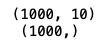


The user must select the number of features to select when initializing the RFE algorithm. This can be specified with the *n_features_to_select* argument. Here we pick 5.


```python
rfe = RFE(estimator=DecisionTreeClassifier(), n_features_to_select=5)
```


In this case, we are using a decision tree classifier as the model to wrap around the RFE algorithm. The decision tree model will be fit to our synthetic data and compute feature importance internally. 

The procedures to fit the RFE wrapper to our ML dataset is similar to fitting a ML model for classification or regression. A cross-validation method is to be used for model fitting and calculate how well the decision tree model fits to our data. 


```python
from sklearn.model_selection import cross_val_score
from sklearn.model_selection import RepeatedStratifiedKFold
from sklearn.pipeline import Pipeline
import numpy as np
```


```python
model = DecisionTreeClassifier()
cv = RepeatedStratifiedKFold(n_splits=5, n_repeats=3, random_state=42)
pl = Pipeline(steps=[('fs',rfe),('m',model)])
n_scores = cross_val_score(pl, x, y, scoring='accuracy', cv=cv)

print('Cross-Validation Accuracy: %.2f (%.2f)' % (np.mean(n_scores), np.std(n_scores)))
```


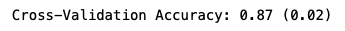


Our RFE (using a decision tree) achieves on average 87% classification accuracy on our data. Fitting the model to our data and then making predictions based on brand new data can be done by fitting the pipeline to the data using *fit()* and using *predict()*. 

However, the point of running RFE was to select *n* features based on feature importance. This information can be extracted by calling the *ranking_* attribute of the fitted RFE model. Calling this attribute returns an array of the same shape as the initial number of features, ranking the features based on importance. Selected features (based on pre-defined number of features to select) are given rank 1. 

Additionally, the *support_* attribute returns a boolean array based on whether the *i*th feature was selected. 


```python
pl.fit(x, y)

rfe.support_

rfe.ranking_
```


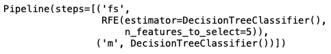

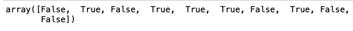

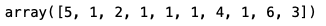


Based on the *ranking_* array, we can see that the model has selected 5 features, as we previously defined. 

Alternatively, sklearn offers a method to determine the optimal number of features using RFE. This can be done with the class *RFECV*. It should be noted that while RFECV method finds the optimal number of features, RFE method selects a predefined number of features. These two methods do two different things.

Therefore, initializing the RFECV does not require the user to specify the number of features to select.


```python
from sklearn.feature_selection import RFECV
rfecv = RFECV(estimator=DecisionTreeClassifier())
pl = Pipeline(steps=[('fs',rfecv),('m',model)])
n_scores = cross_val_score(pl, x, y, scoring='accuracy', cv=cv)

print('Cross-Validation Accuracy: %.2f (%.2f)' % (np.mean(n_scores), np.std(n_scores)))
```


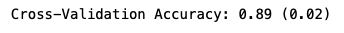


The attribute *n_features_* can be called to identify the number of optimal features as per the RFECV algorithm. In this case, using the decision tree model the RFECV algorithm has deemed the number of features to be used as 7.


```python
pl.fit(x, y)

rfecv.n_features_
```


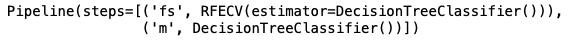

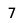


The attribute *grid_scores_* allows us to visualize the cross-validation scores based on the number of features used. As we can see, the lineplot hits its maximum at *n_features* = 7.


```python
rfecv.grid_scores_

import seaborn as sns
import pandas as pd

grid_df = pd.DataFrame({'Score': rfecv.grid_scores_, 'n_features': np.arange(1, len(rfecv.grid_scores_) + 1, dtype = int)})

sns.lineplot(data=grid_df, x="n_features", y="Score")
```


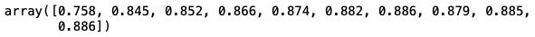

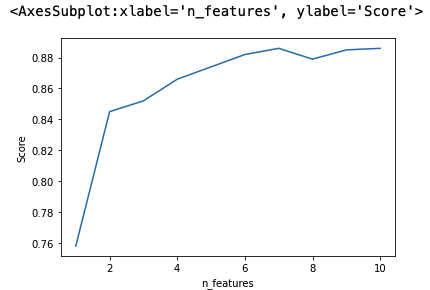


In summary, recursive feature elimination is a supervised feature selection method that wraps around a ML model. This allows user to select *n* number of features to keep based on a recursive model fitting and feature importance calculation. The *RFECV* algorithm can be used to determine the optimal number of features based on model cross-validation accuracy. This allows user to use a much more manageable number of features for downstream classification or regression problems. 

The Jupyter notebook for the code in this post is available on my GitHub repository: https://github.com/snowoflondon/machine_learning_projects